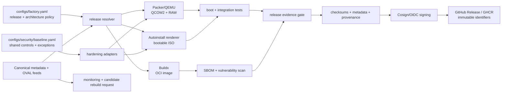

# System architecture

The factory separates trusted configuration, target-specific builders, validation, and publication. An artifact may cross into the publication boundary only after required evidence exists.

## Components and dependencies

| Component | Owns | Depends on | Trust boundary |
| --- | --- | --- | --- |
| Central configuration | Releases, architectures, build defaults, thresholds | YAML + JSON schema | Repository-controlled input |
| Autoinstall path | Installer seed, disk selector, runtime credentials | Python, Ubuntu Server ISO, xorriso | Physical-disk safety boundary |
| VM path | Headless QEMU installation and format conversion | Packer, QEMU, guest firmware, SSH key material | Ephemeral build runner |
| OCI path | Minimal non-root image | Docker/Buildx, official Ubuntu base, Syft/Trivy | Container runtime boundary; no host hardening assumptions |
| Hardening path | SSH, firewall, kernel, audit, update policy | Ansible/target scripts, Ubuntu packages | Host security boundary |
| Evidence layer | Metadata, checksums, SBOM, scan status, provenance | Python, SHA-256, Cosign/GitHub OIDC | Release trust boundary |
| CI orchestration | Validation, scheduled monitoring, candidate builds, release gates | GitHub Actions and external feeds | Remote execution and permission boundary |
| Portfolio audit | Repository contract and executed local gates | Python stdlib, Make, Git | Review evidence boundary |

## Data flow and ownership

1. Release configuration names the supported Ubuntu tracks and canonical source locations.
2. Each target adapter resolves only the inputs it needs; host hardening settings are not copied into OCI behavior.
3. Builders produce local artifacts and metadata. They do not publish directly.
4. Tests and scanners generate evidence. Missing evidence is a failure, not an empty success.
5. Release automation signs and publishes only immutable, traceable outputs.
6. Monitoring opens review work and requests candidate rebuilds; it never promotes an artifact to stable.
