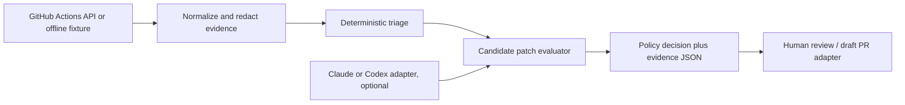

# Next portfolio project: agentic-platform-engineering

Status: design proposal. No repository has been created.

## Product boundary

Build an independent CI repair evaluation system. It consumes a versioned, redacted bundle of workflow/run/job evidence, evaluates the failure and any proposed patch, and emits a deterministic decision with cited evidence. GitHub and agent providers are optional adapters; the local evaluator owns the decision contract. It will not import image-factory modules or publish artifacts.

The first users are maintainers reviewing failed CI and agent-authored draft PRs. The system must distinguish a repository defect from missing credentials, unavailable evidence, and upstream infrastructure failures. It must never treat a successful agent response as proof that a patch is safe.

## Trust and permission model

- Run metadata, logs, issue text, patches, and model output are untrusted input. Store source URLs, commit SHA, run attempt, and acquisition time in each evidence bundle.
- The offline evaluator has no GitHub token, no model key, and no network access. Missing or contradictory evidence yields `insufficient_evidence`, not a guessed repair.
- A later GitHub adapter receives read permissions for runs and checks. A separate, short-lived integration may open draft PRs after evaluation; no component merges, deploys, or changes repository secrets.
- Candidate patch tests execute in an isolated worktree/container with explicit resource limits and no production credentials. Sensitive log content is redacted before persistence or model use.
- Policy and evaluation code are versioned; results record their versions and the exact candidate commit. Human approval remains mandatory for high-risk changes.

## First independently testable milestone

Deliver a typed Python CLI and schema that read local evidence fixtures and write one JSON decision per case. No agent or live GitHub dependency is required.

Fixture set:

1. A validation failure caused by a test pinning an obsolete action SHA → `code_change_candidate` with the failing test and changed action reference cited.
2. A VM build stopped by absent `AUTOINSTALL_*` secrets → `operator_action_required`, with no patch recommendation.
3. A failed Claude action step without accessible logs → `insufficient_evidence`.
4. A successful workflow → `no_action`.
5. An untrusted fork PR supplying instructions in issue text → triage ignores those instructions.
6. Malformed or mismatched run/commit metadata → `invalid_evidence`.

Acceptance: `python -m unittest discover -s tests` passes; a CLI replay of every fixture produces schema-valid JSON twice with identical decisions and evidence references; no fixture contains a real credential; an offline test confirms no network calls or repository writes. The README explains each decision and a reviewer can trace it to input fields. Record actual classification results and any errors; do not claim benchmark accuracy from this small set.

## Subsequent milestones

| Stage | Outcome | Verification |
| --- | --- | --- |
| 2 | GitHub read-only ingestion | Replay an authenticated run and compare normalized output with saved fixture; API errors fail explicitly. |
| 3 | Candidate patch evaluation | Isolated tests, lint, policy checks, and diff provenance produce pass/fail evidence; missing gates block approval. |
| 4 | Agent adapters | Claude/Codex can propose patches through a narrow interface; the same evaluator scores both against held-out fixtures. |
| 5 | Review integration | Only policy-approved candidates may open draft PRs; negative-path tests show no merge, deploy, or secret access. |
| 6 | Observability and maintenance | OpenTelemetry spans correlate ingestion, classification, and evaluation without recording sensitive log bodies; dependency and fixture refresh jobs are documented. |

The GitHub Actions REST API supplies workflow run/job evidence; [GitHub's run API](https://docs.github.com/en/rest/actions/workflow-runs) defines the adapter boundary. [OPA policy tests](https://www.openpolicyagent.org/docs/policy-testing) are an option once policy rules outgrow typed Python predicates. [OpenTelemetry semantic conventions](https://opentelemetry.io/docs/specs/semconv/) provide a later telemetry vocabulary; they do not belong in the first milestone's decision logic.

## Start gate

The image factory's planned week-4 VM boot/security evidence must be executed and reviewed before creating this repository. Specifically: an Ubuntu 26.04 amd64 QCOW2 and RAW build, a boot test showing cloud-init and SSH key access, host security assertions, and a recorded artifact checksum/source commit. The current factory has passing repository validation but lacks that VM evidence. Planning and offline fixture design can proceed now.
